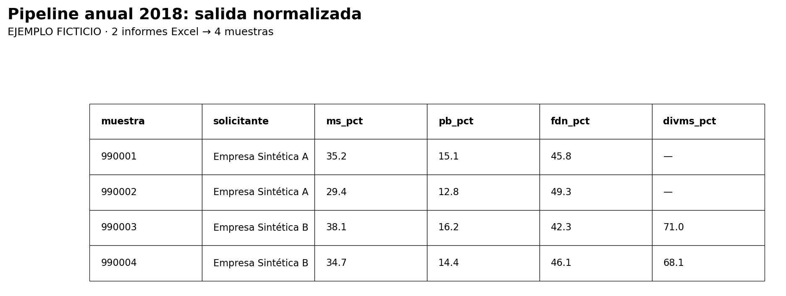
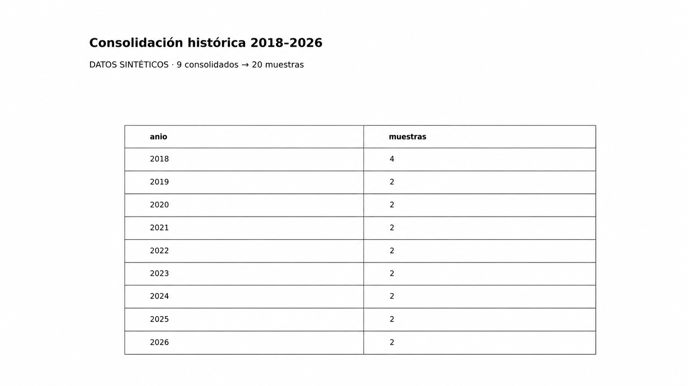

# 🐍 Pipeline en Python para normalización de informes históricos de laboratorio

> ETL con Python · Limpieza de datos históricos · Normalización de archivos Excel · Validación de calidad · Consolidación 2018–2026

---

### 🚀 Resumen del proyecto

**Problema:** Los resultados históricos de laboratorio estaban distribuidos en archivos Excel con diferentes estructuras, lo que dificultaba su consulta y análisis.

**Solución:** Desarrollé un proceso ETL con Python y Pandas para limpiar, estandarizar, validar y consolidar la información histórica.

**Resultado:** Integré datos de **311 archivos con muestras** correspondientes a **2018–2026** en una base de **1.422 registros y 22 columnas**, preparada para futuras consultas y visualizaciones.

*Por confidencialidad, el repositorio incluye código anonimizado y ejemplos con datos ficticios.*

---

## 📈 Resultados reales del proyecto (2018–2026)

La consolidación de los datos históricos **reales** del laboratorio produjo una base unificada con los siguientes resultados. Estas cifras provienen de una verificación agregada de los consolidados anuales y de la base final; **no se publican las fuentes reales**.

| Indicador verificado | Resultado |
|---|---:|
| Período integrado | 2018–2026 (9 años) |
| Archivos fuente con muestras (suma de los conteos anuales) | **311** |
| Registros de la base histórica final | **1.422** |
| Columnas en la base final | **22** |
| Coincidencia entre filas anuales y registros finales | **Sí** |
| Filas con clave `(anio, muestra)` repetida | **0** |

**Desglose de registros reales por año**

| Año | Archivos fuente con muestras | Registros finales |
|---|---:|---:|
| 2018 | 43 | 114 |
| 2019 | 52 | 278 |
| 2020 | 23 | 53 |
| 2021 | 38 | 233 |
| 2022 | 43 | 197 |
| 2023 | 26 | 130 |
| 2024 | 32 | 147 |
| 2025 | 30 | 154 |
| 2026 | 24 | 116 |
| **Total** | **311** | **1.422** |

**Criterio del conteo:** «archivos con muestras» contabiliza las fuentes distintas identificadas en cada consolidado anual. No equivale necesariamente al número total de informes recibidos o intentados. La verificación de duplicados usa la combinación **año + número de muestra**, no el número de muestra por sí solo. No se atribuye un ahorro de tiempo sin medición.

> **Privacidad:** se muestran únicamente cantidades agregadas. Los registros identificatorios, los archivos originales y el consolidado real permanecen fuera del repositorio.

---

## 🔍 Hallazgos agregados del histórico real

Estas conclusiones surgen **solo de estadísticas agregadas**, sin utilizar ni publicar identificadores de las muestras o los solicitantes.

**1. ¿Qué años concentran más registros?**  
Los tres años con mayor cantidad de muestras en la base consolidada fueron **2019 (278)**, **2021 (233)** y **2022 (197)**. Juntos representan **708 registros, el 49,8 % del total**.

**2. ¿La cantidad de registros fue uniforme entre años?**  
No. La cobertura varía desde **53 registros en 2020** hasta **278 en 2019**. Esta diferencia describe la distribución de los datos históricos disponibles; **no permite concluir por sí sola** que aumentó o disminuyó la actividad del laboratorio.

**3. ¿Se conservaron los registros al integrar los años?**  
Sí. Los consolidados anuales suman **1.422 filas**, exactamente las mismas que la base histórica final. No se detectaron registros repetidos con la clave compuesta `(anio, muestra)`. Esto verifica la consistencia de esos recuentos, **no** la ausencia de todos los posibles problemas de calidad.

**Nota de trazabilidad (2021):** una anotación anterior de la bitácora consignaba 236 registros, mientras que el único consolidado anual disponible y la base histórica actual contienen 233. No se conserva la versión previa para reconstruir el origen de la diferencia de 3 registros. Por ello, **233 es el dato vigente verificado** y no se atribuye una causa no demostrada.

---

## 📊 Evidencia de funcionamiento (datos 100 % ficticios)

Para demostrar que los scripts publicados funcionan sin exponer registros reales, se creó un escenario completamente sintético y se ejecutaron ambos pipelines. **Las cifras siguientes corresponden solo a la demostración y no representan los resultados del laboratorio real.**

| Indicador de la demostración | Resultado |
|---|---:|
| Informes ficticios de entrada (2018) | 2 |
| Muestras procesadas por el pipeline de 2018 | 4 |
| Años integrados por el consolidador histórico | 9 (2018–2026) |
| Registros finales de prueba | 20 |
| Errores de lectura del histórico | 0 |
| Muestras duplicadas en la demostración | 0 |

**Validaciones demostradas:** identificación de encabezados desplazados y de dos filas, normalización de variables, promedio de determinaciones repetidas de DIVMS, unión de consolidados anuales y exportación de logs.





[Ver control de valores faltantes](images/03_control_nulos_ficticio.png) · [Explorar los ejemplos Excel y las instrucciones de reproducción](outputs_sample/README.md)

> **Alcance de la prueba:** los informes de 2018 se procesaron con el script anual publicado. Los consolidados ficticios de 2019–2026 se prepararon directamente para probar el script maestro: **no** se generaron ejecutando pipelines anuales que no están incluidos en este repositorio.

---

## ⚙️ Stack tecnológico

| Herramienta / Librería | Uso |
|---|---|
| Python | Desarrollo del pipeline de procesamiento |
| Pandas | Lectura, transformación, validación y consolidación de datos |
| OpenPyXL | Lectura y escritura de archivos `.xlsx` |
| xlrd | Lectura de archivos históricos `.xls` |
| lxml | Lectura alternativa de archivos `.xls` exportados como HTML |
| re | Normalización de textos y encabezados |
| os / glob | Búsqueda automática de archivos en carpetas |

---

## ❔ Objetivo del proyecto

El objetivo general del proyecto es construir una base histórica confiable de resultados de laboratorio que permita consultar rápidamente información analítica acumulada durante varios años.

Originalmente, los resultados se encontraban distribuidos en múltiples informes Excel con estructuras variables. Esto dificultaba responder de forma rápida preguntas frecuentes del trabajo técnico, como:

- ¿Cuáles fueron los resultados de análisis de una muestra determinada?
- ¿Qué características analíticas presentó un cultivo, alimento o material evaluado?
- ¿Qué resultados históricos existen para un productor o solicitante específico?
- ¿Qué cultivos o alimentos fueron analizados con mayor frecuencia?
- ¿Cómo consultar información histórica sin revisar archivo por archivo?

Este repositorio documenta la **primera etapa del proyecto**: el desarrollo de un pipeline en Python para normalizar, validar y consolidar los informes históricos del período 2018–2026. El código compartido es una selección anonimizada de esa implementación.

El resultado de esta etapa es una base histórica limpia y estandarizada, que funciona como insumo para una etapa posterior de consulta, análisis y visualización.

---

## 📌 Contexto

El laboratorio contaba con informes históricos generados en Excel durante varios años. Estos archivos no tenían una estructura completamente uniforme, lo que dificultaba su consolidación directa.

Entre los principales problemas detectados se encontraban:

- Archivos en formatos `.xlsx` y `.xls`.
- Encabezados ubicados en distintas filas.
- Encabezados de una o dos filas.
- Diferentes nombres para una misma variable analítica.
- Metadatos ubicados antes de la tabla principal.
- Columnas fuera del alcance del proyecto.
- Valores faltantes representados de distintas formas.
- Informes con tablas ubicadas horizontalmente.
- Archivos acumulativos o versiones incompletas.
- Errores de escritura y abreviaturas históricas.

Por este motivo, se decidió utilizar Python como herramienta principal para construir una etapa de normalización previa al análisis.

---

## 🧭 Alcance de esta etapa

Este repositorio corresponde a la etapa de preparación y consolidación de datos.

El foco de esta etapa fue resolver el problema de base: transformar archivos históricos dispersos y heterogéneos en una estructura única, confiable y reutilizable.

Incluye:

- lectura automática de informes históricos;
- normalización de estructuras diferentes;
- estandarización de nombres de variables;
- tratamiento de errores, valores faltantes y excepciones;
- validación anual de los datos;
- consolidación final del período 2018–2026;
- generación de logs de control.

No incluye todavía la etapa completa de visualización o dashboard.  
Esa etapa se desarrollará a partir de la base histórica generada por este pipeline.

---

## 🗂️ Estructura del repositorio

```text
pipeline-laboratorio-python/
├── scripts/
│   ├── pipeline_2018.py
│   └── pipeline_maestro_consolidado_historico_2018_2026.py
├── docs/
│   └── bitacora_tecnica.md
├── images/                             # 3 capturas ficticias
├── outputs_sample/                     # Excel y logs ficticios + guía
│   └── consolidados_anuales_sinteticos/
├── config_privada.ejemplo.json
├── requirements.txt
├── .gitignore
└── README.md
```

- **`scripts/`**: pipeline anual base de 2018 y consolidador histórico.
- **`docs/`**: [bitácora técnica](docs/bitacora_tecnica.md) con decisiones y adaptaciones del proyecto.
- **`config_privada.ejemplo.json`**: configuración demostrativa sin información real.
- **`requirements.txt`**: dependencias Python.
- **`.gitignore`**: impide versionar datos y configuraciones privadas en un flujo Git habitual.

Las carpetas `images/` y `outputs_sample/` contienen únicamente una demostración ficticia. Los Excel de laboratorio reales no están disponibles en este repositorio.

---

## 🔄 Flujo general de esta etapa

```text
Archivos Excel originales
        ↓
Pipeline anual en Python
        ↓
Consolidado anual validado
        ↓
Script maestro histórico
        ↓
Base histórica 2018–2026
        ↓
Dataset preparado para consulta y análisis
```

Los archivos originales se conservaron sin modificaciones.

Las reglas generales se documentan en el código y la bitácora. Las correcciones y exclusiones específicas que contienen identificadores reales se conservan exclusivamente en una configuración local no publicada.

La base resultante será utilizada en una etapa posterior para construir una herramienta de consulta y visualización que permita explorar la información histórica de forma más rápida y accesible.

---

## 🧩 Desarrollo del pipeline

### Caso base: año 2018

El año 2018 fue utilizado como caso base para construir la lógica principal del pipeline, ya que presentaba varias diferencias estructurales entre archivos.

Durante esta etapa se desarrollaron funciones para:

- Leer archivos `.xlsx` y `.xls`.
- Detectar automáticamente la fila donde comienza la tabla de muestras.
- Identificar si el encabezado ocupa una o dos filas.
- Normalizar nombres de columnas.
- Extraer metadatos del informe.
- Filtrar únicamente filas correspondientes a muestras reales.
- Convertir variables analíticas a formato numérico.
- Excluir columnas fuera del alcance del proyecto.
- Registrar avisos, errores y controles de trazabilidad.
- Exportar un consolidado anual y un log de control.

---

## 🔎 Funciones principales del pipeline

### `limpiar_texto()`

Normaliza los encabezados para poder compararlos aunque estén escritos de forma distinta.

Ejemplos:

```text
% Almidón   → almidon
Muestra Nº  → muestrano
ENERGIA Mcal/kg MS → energiamcalkgms
```

Esta función permite luego buscar cada encabezado dentro de un diccionario de equivalencias.

### `buscar_encabezado()`

Recorre el archivo fila por fila y columna por columna hasta encontrar dónde comienza la tabla de muestras.

Esto permite procesar archivos donde la tabla no siempre empieza en la misma fila.

### `extraer_metadatos()`

Extrae información general ubicada antes de la tabla principal, como:

- solicitante;
- localidad;
- fecha de ingreso;
- fecha de egreso.

Estos datos se agregan luego a cada muestra procesada.

### `procesar_reporte()`

Es la función principal del pipeline anual.

Su objetivo es procesar un informe individual y devolver una tabla estandarizada con sus muestras.

Entre sus tareas se incluyen:

- leer el archivo;
- ubicar el encabezado;
- construir nombres de columnas estandarizados;
- eliminar filas que no corresponden a muestras;
- convertir resultados analíticos a formato numérico;
- agregar metadatos;
- registrar avisos;
- devolver un DataFrame limpio.

---

## 🧱 Normalización de columnas

Se utilizó un diccionario llamado `MAPEO_COLUMNAS` para unificar diferentes nombres históricos que representaban una misma variable.

| Nombre detectado | Nombre estandarizado |
|---|---|
| `LDAs` | `lignina_pct` |
| `% NT` | `nt_pct` |
| `% PB` | `pb_pct` |
| `% EE` | `extracto_etereo_pct` |
| `% N` | `nt_pct` |
| `ENERGIA Mcal/kg MS` | `em_mcal_kg_ms` |

Esto permitió consolidar información histórica aunque los encabezados no fueran idénticos entre años.

---

## 🧪 Problemas de calidad detectados y soluciones aplicadas

| Problema detectado | Solución implementada |
|---|---|
| Encabezados en diferentes filas | Detección automática del inicio de la tabla |
| Encabezados de una o dos filas | Regla dinámica según el contenido debajo de `Muestra` |
| Archivos `.xls` y `.xlsx` | Lectura con librerías específicas según formato |
| Variables con distintos nombres históricos | Diccionario de equivalencias `MAPEO_COLUMNAS` |
| Columnas fuera del alcance | Exclusión documentada mediante `COLUMNAS_EXCLUIDAS` |
| Archivos duplicados o acumulativos | Exclusión controlada mediante `ARCHIVOS_EXCLUIDOS` |
| Valores dobles en una celda | Separación, conversión y cálculo del promedio |
| Guion `-` como ausencia de dato | Conversión a valor faltante (`NaN`) |
| Tablas horizontales dentro de una hoja | Procesamiento por bloques y unificación vertical |
| Metadatos ausentes en archivos originales | Conservación como valores faltantes y registro en log |
| Errores ortográficos o abreviaturas | Incorporación de nuevas reglas de mapeo |

---

## 📆 Adaptación del pipeline por año

La lógica desarrollada para 2018 se adaptó internamente para procesar los años 2019 a 2026. Esas versiones anuales incorporaron reglas para diferencias estructurales detectadas en cada período.

| Año | Mejora documentada |
|---|---|
| 2019 | Nuevas variables históricas y bloques horizontales |
| 2020 | Promedio de determinaciones dobles y corrección documentada de metadatos |
| 2021 | Exclusión de variantes de `Peso seco` |
| 2022 | Tratamiento del guion como dato faltante y tablas horizontales |
| 2023 | Procesamiento sin nuevas incidencias |
| 2024 | Mapeo de `%EE` a `extracto_etereo_pct` |
| 2025 | Procesamiento sin nuevas incidencias |
| 2026 | Mapeo de `%N` a `nt_pct` y respeto de metadatos ausentes |

**Alcance del código compartido:** se publica el pipeline base de **2018** y el **script maestro** que integra los consolidados anuales. Las versiones internas adaptadas para **2019–2026 no se incluyen**; por lo tanto, este repositorio por sí solo no reproduce la normalización de todos los años desde cero. La documentación histórica completa está en la bitácora.

---

## 🧾 Script maestro histórico

Luego de validar los consolidados anuales, se desarrolló un script maestro para unificar todos los años en una única base histórica.

El script maestro realiza las siguientes tareas:

- Lee los consolidados anuales de 2018 a 2026.
- Agrega una columna `anio`.
- Une todos los archivos mediante Pandas.
- Estandariza nombres de columnas.
- Renombra `observaciones` como `cultivo`.
- Estandariza `cultivo` en mayúsculas.
- Convierte fechas a formato fecha.
- Redondea variables analíticas a dos decimales.
- Elimina columnas no necesarias para la base final.
- Trata columnas sin nombre.
- Genera controles de calidad históricos.
- Exporta una base final y un log de control.

---

## ✅ Controles de calidad

El pipeline genera controles tanto a nivel anual como histórico.

Entre los controles aplicados se encuentran:

- cantidad de archivos procesados;
- cantidad de muestras consolidadas;
- errores de procesamiento;
- números de muestra duplicados;
- fechas de egreso anteriores a la fecha de ingreso;
- fechas fuera del período esperado;
- valores fuera de rangos analíticos;
- valores nulos por columna;
- cobertura de variables analíticas;
- trazabilidad por archivo;
- avisos y errores en archivos de log.

---

## 📤 Salidas generadas

El proceso genera dos archivos principales:

```text
consolidado_historico_2018_2026.xlsx
log_consolidado_historico_2018_2026.xlsx
```

### Base histórica final

Contiene la información consolidada y estandarizada de los informes históricos del laboratorio.

Incluye variables como:

- `anio`
- `muestra`
- `solicitante`
- `localidad`
- `fecha_ingreso`
- `fecha_egreso`
- `cultivo`
- `ms_pct`
- `nt_pct`
- `pb_pct`
- `fdn_pct`
- `fda_pct`
- `lignina_pct`
- `divms_pct`
- `em_mcal_kg_ms`
- `extracto_etereo_pct`
- `celulosa_pct`

### Log de control

Contiene información de validación del proceso:

- resumen por año;
- columnas por consolidado anual;
- valores nulos por columna;
- cobertura de variables analíticas;
- duplicados;
- fechas inconsistentes;
- columnas sin nombre tratadas;
- avisos;
- errores.

---

## 🔐 Confidencialidad de los datos

Este proyecto se desarrolló con registros históricos reales de laboratorio. Por confidencialidad, **no se publican informes originales, números de muestras reales, datos de solicitantes, consolidados ni logs reales**.

Las rutas personales, correcciones específicas y exclusiones de muestras o informes se mantienen fuera del repositorio en `config_privada.json`, archivo expresamente ignorado por Git. El repositorio incluye únicamente una configuración de ejemplo ficticia.

Los ejemplos futuros de entrada y salida se crearán con datos completamente sintéticos.

---

## ⚠️ Limitaciones y reproducibilidad

- El código público incluye el pipeline base de 2018 y el consolidador final, pero no los scripts anuales adaptados de 2019 a 2026.
- El script maestro necesita archivos `consolidado_2018.xlsx` a `consolidado_2026.xlsx` previamente generados; no se distribuyen las bases reales.
- Las correcciones privadas específicas solo se aplican si existe una configuración local autorizada.
- Los resultados documentados describen el proyecto histórico; no deben confundirse con resultados de una ejecución pública sobre datos sintéticos.
- La herramienta de consulta y visualización constituye una etapa posterior.

---

## ▶️ Cómo ejecutar los scripts

1. Crear un entorno Python e instalar las dependencias:

```bash
pip install -r requirements.txt
```

2. Para probar el script anual de 2018, ubicar archivos Excel **propios o sintéticos** en `DATOS/ORIGINALES/2018/`. Por defecto, el script trabaja con rutas relativas a la raíz del proyecto y genera el consolidado en `DATOS/RESPALDOS/`. También se pueden configurar rutas locales mediante `PIPELINE_LAB_RAIZ` o `PIPELINE_LAB_CONFIG`.

3. Ejecutar `scripts/pipeline_2018.py`. Se generarán `consolidado_2018.xlsx` y `log_consolidado_2018.xlsx`, siempre que existan informes de entrada compatibles.

4. **Solo si se dispone de los nueve consolidados anuales**, ejecutar `scripts/pipeline_maestro_consolidado_historico_2018_2026.py`. Este lee los consolidados desde `DATOS/RESPALDOS/` y exporta la base histórica y los controles a `DATOS/PROCESADOS/`.

> No copiar archivos reales del laboratorio a este repositorio. La configuración privada local no debe compartirse ni subirse a GitHub.

---

## ⏳ Estado del proyecto

Estado actual: **Etapa 1 finalizada**.

Esta etapa incluyó:

- normalización de archivos históricos;
- validación anual del período 2018–2026;
- consolidación histórica final;
- generación de logs de control;
- construcción de una base limpia y reutilizable.

Próxima etapa:

- diseño de una herramienta de consulta y visualización;
- creación de métricas e indicadores;
- desarrollo de filtros por muestra, cultivo, productor y año;
- análisis exploratorio de la información histórica.

---

## 💎 Aprendizajes principales

Este proyecto permitió trabajar con un caso real de datos históricos no estandarizados.

Los principales aprendizajes fueron:

- diseñar un pipeline reproducible en Python;
- separar datos originales de datos procesados;
- documentar reglas de negocio y excepciones;
- construir funciones reutilizables;
- validar resultados mediante logs;
- tratar datos faltantes sin reemplazarlos incorrectamente por cero;
- resolver diferencias históricas de formato y nomenclatura;
- generar una base analítica confiable a partir de archivos operativos desordenados.
